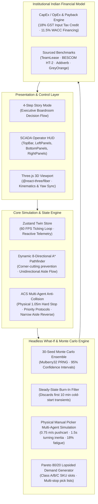

# NexusTwin: Autonomous Warehouse Digital Twin & Automation Decision Engine

[](https://github.com/Farooq/nexustwin/actions/workflows/ci.yml)
[](LICENSE)
[](https://www.typescriptlang.org/)
[](https://threejs.org/)
[](https://vitest.dev/)

**NexusTwin** is an institutional-grade 3D Digital Twin and headless Monte Carlo simulation engine that de-risks multi-crore warehouse automation decisions for fulfillment centers, 3PLs, and quick-commerce dark stores.

Instead of relying on linear vendor spreadsheets that overlook spatial congestion, NexusTwin simulates physical multi-agent dynamics—running autonomous mobile robots (AMRs) and human pushcart pickers side by side under real-world operational shock.

---

## 🏛️ System Architecture



---

## 🚀 Key Differentiators & Credibility Foundations

### 1. Fair Physical Baseline: Simulated Human Pickers vs AMRs
Most commercial ROI calculators use an abstract heuristic (`orders ÷ 45`). NexusTwin physically simulates human pickers as autonomous spatial agents:
- **Kinematics**: $0.75\text{ m/s}$ walking velocity laden with a 4-tote manual pushcart.
- **Cornering Latency**: $1.5\text{ s}$ turning inertia delay when negotiating 90° rack intersections.
- **Fatigue Degradation**: 18% linear velocity reduction over an 8-hour shift.
- **Aisle Contention**: Single-lane $1.5\text{m}$ rack aisles prevent pushcarts from passing; inbound pickers hold at cross-aisle entry until the outbound cart exits.

### 2. 30-Seed Monte Carlo Confidence Bands with Steady-State Burn-In
- **Burn-In Discard**: Discards the first 10 simulated minutes (6,000 ticks @ 100ms/tick) to remove empty-warehouse initialization artifacts.
- **30-Seed Ensemble**: Computes Mean, Median, Standard Deviation ($\sigma$), and 95% Confidence Intervals ($\text{Mean} \pm 1.96 \frac{\sigma}{\sqrt{N}}$) for payback period, SLA fulfillment, and floor bottleneck risk.

### 3. Institutional Indian Financial Model (With Sourced Citations)
Built specifically for Indian logistics infrastructure economics:
- **18% GST Input Tax Credit (ITC)**: Automatically accounted for under Section 16 of the Central Goods and Services Tax Act 2017, reducing capitalized CapEx basis.
- **11.5% WACC Equipment Financing**: 60-month commercial debt / equipment lease amortization.
- **Blended Power Tariffs**: 85% commercial grid electricity (BESCOM HT-2 @ ₹8.50/kWh) + 15% backup diesel generator operating cost (₹28.00/kWh).
- **Non-Eliminable Retained Staff**: Accounts for essential on-site specialists (1 Automation Systems Supervisor + 2 Robotics Maintenance Techs + 2 Exception Handlers = ₹1.49 Lakhs/month).

### 4. Published Commercial AMR Specifications
Evaluates representative commercial robot profiles with authentic manufacturer datasheets:
- **Addverb Dynamo 200 Class**: $200\text{ kg}$ payload, $1.8\text{ m/s}$ speed, $1.2\text{ m/s}^2$ acceleration, 24V 22Ah LTO fast-charging battery (8-minute opportunity charge).
- **GreyOrange Butler M Class**: $500\text{ kg}$ payload (mobile storage unit rack lifter), $1.5\text{ m/s}$ speed, 2.4 kWh Li-ion.
- **UnboxSort SR-550 Class**: $25\text{ kg}$ payload, $3.0\text{ m/s}$ speed, high-speed parcel sortation AMR.

---

## 📊 Sourced Benchmark Citations

| Parameter | Value | Industrial / Legal Source | Application in Model |
|-----------|-------|---------------------------|----------------------|
| **Manual Picker Wage** | ₹18,000 / mo | TeamLease Logistics Employment Report 2024–25 | Base labor rate across Tier-1/Tier-2 Indian hubs |
| **Contractor Markup** | 22% statutory fee | TeamLease / Quess Corp Commercial Standards | Covers mandatory PF, ESI, gratuity, and agency margin |
| **Festive Wage Premium** | 35% spot surcharge | Indian 3PL Peak Season Industry Data | Diwali / BBD / Great Indian Festival spot-hiring premium |
| **Grid Power Tariff** | ₹8.50 / kWh | BESCOM HT-2 Commercial Tariff Schedule | Standard high-tension warehouse utility rate |
| **Diesel Genset Tariff** | ₹28.00 / kWh | Blended DG Genset Running Costs (0.28 L/kWh) | Backup generator power during localized grid outages |
| **GST Input Tax Credit** | 18% tax credit | CGST Act 2017, Section 16 | 100% claimable tax offset on capital automation assets |
| **Cost of Capital (WACC)** | 11.5% p.a. | Reserve Bank of India Logistics Asset Leasing | Equipment leasing / commercial debt amortization over 5 years |

---

## ⚡ 3-Minute Judge Evaluation Runbook

1. **Clone & Install**:
   ```bash
   git clone https://github.com/Farooq/nexustwin.git
   cd nexustwin
   npm install
   ```

2. **Run Unit & Regression Test Suites**:
   ```bash
   npm run test
   ```
   *Expected Output: 4 test suites passed (Pathfinder, Anti-Collision, Determinism, ROI Model), 12/12 tests green.*

3. **Launch the Development Server**:
   ```bash
   npm run dev
   ```
   Open `http://localhost:3000` (or `http://localhost:5173`) in your browser.

4. **Evaluate 4-Step Story Mode**:
   - **01 / BUILD**: Adjust footprint sliders ($84\text{m} \times 52\text{m}$) and rack clusters; watch the dynamic A* cost grid provision in real time.
   - **02 / STRESS**: Inject the *Diwali 3.2X Festive Surge* or *Aisle Blockade*; observe the Anti-Collision System (ACS) resolve deadlocks via cooperative sidestepping and reverse maneuvering.
   - **03 / COMPARE**: Inspect the side-by-side physical simulation comparing manual pushcarts ($0.75\text{ m/s}$, fatigue curve) with autonomous AMRs ($1.8\text{ m/s}$, +178% pace).
   - **04 / DECIDE**: Review the audited board-ready payback card with 95% Monte Carlo confidence intervals and 18% GST Input Tax Credit tax deductions. Click **📚 Sourced Benchmarks** to inspect the legal and economic citations.

5. **Switch to SCADA Operator HUD**:
   - Click **Operator View →** in the top-right header to switch to the full industrial SCADA operations console with 3D camera controls, live bot telemetry, floor heatmaps, and instant scenario drawers.

---

## 🛠️ Tech Stack & Dependencies

- **Frontend & UI**: React 18, TypeScript 5.6, Zustand 5.0
- **3D Graphics**: Three.js r169, @react-three/fiber, @react-three/drei
- **Algorithms**: 8-Directional A* Pathfinder, Priority-based Anti-Collision, Mulberry32 PRNG
- **Testing & Tooling**: Vitest 2.1, Vite 5.4, GitHub Actions CI

---

## 📄 License

This project is licensed under the MIT License - see the [LICENSE](LICENSE) file for details.
