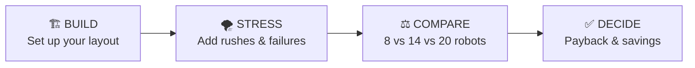
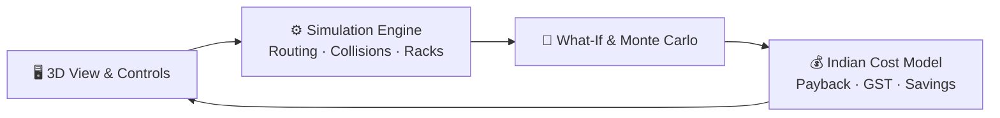

<h1 align="center">🏭 NexusTwin</h1>
<h3 align="center">Test your warehouse robots in 3D <i>before</i> you buy them.</h3>

<p align="center">
  <a href="https://github.com/mo-farooq/NexusTwin/actions/workflows/ci.yml"></a>
  
  
  <a href="LICENSE"></a>
</p>

<p align="center">
  
</p>

<p align="center">
  <b><a href="YOUR_LINK/#story">🔗 Live Demo</a></b> ·
  <b><a href="YOUR_LINK">🎥 2-min Video</a></b> ·
  <b><a href="#-run-it-in-3-minutes">⚡ Run Locally</a></b>
</p>

---

## 🤔 The Problem

Indian warehouses and dark stores are buying robots, and the **people selling the robots** decide how many they need.

Vendors earn more when you buy more. So they size fleets for the worst possible day, not a normal one.

> **Think of it like traffic:** adding more cars to a narrow lane doesn't get everyone home faster. It causes a jam.

**Example:** A vendor quotes **20 robots for ₹1.6 Crore**. About **10** would do the job. The extra 10 crowd the 2-metre aisles, cause **38% more congestion**, and actually *slow the warehouse down*.

## 💡 What NexusTwin Does

NexusTwin is a free, independent 3D simulator that works for the **buyer**, not the seller.

1. **🏗️ Build** your warehouse in 3D, or start from a ready-made Indian layout (Zepto-style dark store, Bhiwandi 3PL hub, Peenya MSME depot).
2. **🌪️ Stress-test it** with real problems: a 3.2× Diwali rush, a blocked aisle, a jammed conveyor, a broken robot.
3. **✅ Get the answer:** how many robots you really need, and how long until they pay for themselves, using real Indian costs (wages, electricity, 18% GST credit).

**Result:** buyers can avoid spending **₹40–60 Lakhs** on robots they don't need.

## ⚖️ Vendor Spreadsheet vs NexusTwin

| | Vendor Spreadsheet | NexusTwin |
|---|---|---|
| **Works for** | The seller | The buyer |
| **Robot traffic jams** | Ignored | Simulated in 3D |
| **Top-shelf picks** (Level 4 takes 11s vs 2s on Level 1) | Treated the same | Modelled, including battery drain |
| **Festival rush** | Not tested | Diwali 3.2× surge |
| **How sure is the answer?** | One number | 30 runs with a 95% confidence range |

## 🔄 How It Works



## 🕹️ Two Modes

| 🎬 Story Mode (`#story`) | 🖥️ Operator Mode (`#operator`) |
|---|---|
| **For managers & investors.** A guided 4-step walkthrough that ends with a clear buy/don't-buy answer. | **For warehouse teams.** A live 3D control room with layout builder, what-if testing, weekly shelf rebalancing and an exportable event log. |

---

## ⚡ Run It in 3 Minutes

```bash
git clone https://github.com/mo-farooq/NexusTwin.git
cd NexusTwin
npm install
npm run test   # 29/29 tests pass in ~1.3s
npm run dev    # open http://localhost:3000
```

## 🧑‍⚖️ Judge's Quick Tour

**Story Mode**
1. **BUILD:** move the width slider and watch the route grid update live.
2. **STRESS:** click `Inject 3.2X Festive Surge` and watch the robots avoid each other.
3. **COMPARE:** toggle `1.0x / 1.35x / 1.75x` to see how fleet size changes payback.
4. **DECIDE:** read the final verdict card and click `📚 Sourced Benchmarks`.

**Operator Mode** (click `Operator View →`)
- `🏗️ Studio Builder` → `Load Sample MSME Blueprint`
- `⚡ Decision Sandbox` → **Payback** tab (vendor quote vs real need)
- `🧪 What-If` → `Festive Season 3x Flash Load` → **Run** (simulates 5 minutes in ~200ms)
- `🔄 Weekly Slotting` → move fast-selling items from Level 4 to Level 1

---

## 🛠️ Built With

React 18 · TypeScript 5.6 · Three.js (react-three-fiber) · Zustand · Vite · Vitest · GitHub Actions

<details>
<summary><b>🔬 Under the hood (for technical judges)</b></summary>

<br>

- **Smart routing:** traffic-aware 8-direction A* pathfinding with turn penalties and one-way aisles.
- **Collision avoidance:** each robot has a LiDAR "safety bubble" (Caution → Hold → Hard Stop), plus sidestep and reverse to break deadlocks.
- **Humans on the floor:** workers cross aisles; robots detect them and stop.
- **Shelf height matters:** 4 rack levels, each with its own lift time and battery cost.
- **Repeatable results:** a seeded random generator (Mulberry32) on a 10 Hz clock. The same inputs always give the same output.
- **Fast what-if:** clones the live simulation in memory and fast-forwards 5 minutes across multiple seeds in ~200ms.
- **Confidence:** a 30-run Monte Carlo gives 95% confidence ranges, not a single guess.
- **Manual baseline:** compared against human pushcart picking (0.75 m/s, 1.5s per turn, 18% fatigue → 28 picks/hr).


</details>

<details>
<summary><b>📊 Where the numbers come from</b></summary>

<br>

| What | Value | Source |
|---|---|---|
| Picker wage | ₹18,000 / month | TeamLease Logistics Employment Report 2024–25 |
| Staffing agency fee | 22% | TeamLease / Quess Corp |
| Festival hiring premium | 35% | Indian 3PL peak-season data |
| Grid electricity | ₹8.50 / kWh | BESCOM HT-2 tariff |
| Diesel generator power | ₹28.00 / kWh | Blended DG running cost |
| GST input tax credit | 18% | CGST Act 2017, Section 16 |
| Cost of capital | 11.5% / year | RBI logistics asset financing |
</details>

<details>
<summary><b>❓ FAQ</b></summary>

<br>

**Why not just use the vendor's free simulation?**
Vendors sell hardware, so their tools lean toward bigger fleets, and each one only models its own brand. NexusTwin is neutral and shows exactly where extra robots cause jams.

**Isn't this a one-time tool?**
No. Stock changes with every season (Diwali gift boxes, summer drinks). The Weekly Slotting tool keeps fast sellers on low shelves. In our test, that cut pick time by 36%.

**Why 3D? Wouldn't Excel do?**
Excel assumes "more robots = more output". It can't see robots blocking each other in narrow aisles, slow top-shelf picks, or conveyor pile-ups.

**Do I need to enter all my data?**
No. Start from one of 3 pre-set Indian warehouse types, each filled with realistic defaults.

**Does it work with existing systems?**
It exports CSV/JSON for tools like Unicommerce, Increff, Vinculum and SAP.
</details>

<details>
<summary><b>📁 Project structure</b></summary>

<br>

```
src/
├── engine/       # Pathfinding, auto-zoning, human traffic, what-if runner
├── store/        # Simulation state, cost model, slotting
└── components/   # 3D scene, Story Mode, Operator panels
test/             # 7 test suites, 29 tests
```
</details>

---

<p align="center">MIT License · Built for Indian warehouses 🇮🇳</p>
