# NexusTwin: Institutional 3D Digital Twin & Warehouse Automation Decision Engine

[](https://github.com/mo-farooq/NexusTwin/actions/workflows/ci.yml)
[](LICENSE)
[](https://www.typescriptlang.org/)
[](https://threejs.org/)
[](https://vitest.dev/)
[](https://github.com/mo-farooq/NexusTwin)

**NexusTwin** is an institutional-grade, client-side 3D Digital Twin, Anti-Overselling Firewall, and Spatial Decision Sandbox designed to de-risk multi-crore warehouse automation decisions for Indian quick-commerce dark stores, third-party logistics (3PL) hubs, and MSME fulfillment centers.

Instead of relying on linear vendor spreadsheets that overlook physical spatial congestion, NexusTwin simulates physical multi-agent dynamics—modeling autonomous mobile robots (AMRs), vertical rack kinematics, and pedestrian safety corridors under real-world operational shock—calculating exact CapEx payback with 30-seed Monte Carlo confidence bands.

---

## 🏛️ System Architecture

```mermaid
flowchart TD
    subgraph UI_Layer ["Presentation & Control Layer"]
        Story["4-Step Executive Story Mode\n(#story · Boardroom CapEx Decision Walkthrough)"]
        SCADA["SCADA Industrial Operator Console\n(#operator · TopBar, Telemetry Rails, FPV Feed, Ledgers)"]
        ThreeCanvas["Three.js 3D Isometric Viewport\n(@react-three/fiber · Kinematics, Wheel Rotation, LiDAR Cones)"]
    end

    subgraph State_Engine ["Core Simulation & State Engine"]
        ZStore["Zustand Twin Store\n(Deterministic 10 Hz Clock · Reactive Telemetry)"]
        AStar["Traffic-Weighted 8-Directional A* Pathfinder\n(Turn penalties, corner-cutting checks, one-way aisle flow)"]
        ACS["Multi-Agent Anti-Collision System (ACS)\n(LiDAR safety bubbles: Caution, Holding, Hard Stop & Deadlock Back-off)"]
        Slotting["4-Tier Vertical Storage Kinematics\n(Levels 1–4 lift duration, battery draw multipliers & SKU velocity)"]
    end

    subgraph Virtual_Engine ["Virtual Testing & Headless What-If Runner"]
        WhatIf["In-Memory Headless What-If Runner\n(Deep clones live state · Fast-forwards 5 min in 200ms)"]
        MC["30-Seed Monte Carlo Ensemble\n(Mulberry32 PRNG · 95% Confidence Intervals & Burn-In Filter)"]
        Brownfield["AI Auto-Zoner & Blueprint Scanner\n(HTML5 CV wall & pillar detector · 3 Indian facility archetypes)"]
        Benchmarking["Manual Pushcart Benchmark Engine\n(0.75 m/s laden speed · 1.5s cornering delay · 18% shift fatigue)"]
    end

    subgraph Financial_Engine ["Institutional Indian Financial Model"]
        ROI["CapEx / OpEx & Payback Engine\n(18% GST Input Tax Credit · 11.5% WACC Equipment Financing)"]
        Oversell["Anti-Overselling Firewall\n(Vendor pitch overbuy quote vs. NexusTwin verified optimum)"]
        Benchmarks["Sourced Indian Industrial Benchmarks\n(TeamLease · Quess Corp · BESCOM HT-2 · Addverb · GreyOrange)"]
    end

    UI_Layer --> State_Engine
    State_Engine --> Virtual_Engine
    Virtual_Engine --> Financial_Engine
    Financial_Engine --> UI_Layer
```



---

## 🎯 The Core Problem: The "Vendor Pitch" vs. "Spatial Reality" Trap

When an Indian warehouse or 3PL operator plans automation, robot OEMs (such as Addverb, GreyOrange, or Hikrobot) provide free 3D simulation videos and spreadsheets. 

### Why Vendor Simulations Trap the Buyer:
1. **Incentivized Overselling**: Robot vendors make revenue on hardware CapEx and annual maintenance contracts (AMC). Their algorithms size fleets for theoretical peak surges rather than operational equilibrium (e.g., quoting **20 AMRs for ₹1.6 Crore** when 10 AMRs would suffice).
2. **Spreadsheets Ignore Physical Space**: A 2D spreadsheet calculates linear throughput ($N \times \text{speed}$). In real 2-meter warehouse aisles, packing 20 robots triggers continuous head-on LiDAR slowdowns and mutual yield deadlocks, causing an **overbuy congestion spike of +38%** that actually *drops* throughput.
3. **Z-Axis Lift Latency**: Level 4 top-shelf picking takes **11.0 seconds and 2.6× battery power** vs. **2.0 seconds** on Level 1. Spreadsheets treat every pick identically, missing battery exhaustion.

> **NexusTwin's Positioning:** NexusTwin is the **buyer's independent advocate**. It exposes vendor oversizing, proves where adding more robots creates gridlock, and saves buyers **₹40–₹60 Lakhs in unneeded CapEx** before contracts are signed.

---

## 🕹️ Two Specialized Operational Modes

NexusTwin provides two distinct modes for different stakeholders:

```
┌─────────────────────────────────────────────────────────────────────────────┐
│                          NEXUSTWIN OPERATING MODES                          │
├──────────────────────────────────────────┬──────────────────────────────────┤
│ 1. Executive Story Mode (#story)         │ 2. SCADA Operator Console (#operator)│
├──────────────────────────────────────────┼──────────────────────────────────┤
│ • 01 / BUILD: Dimension & Grid Tuning    │ • 60 FPS Three.js Facility View  │
│ • 02 / STRESS: Chaos & Surges            │ • Studio Builder (CAD / Blueprints)│
│ • 03 / COMPARE: Fleet Sizing (8 vs 20)   │ • Decision Sandbox (CapEx Payback)│
│ • 04 / DECIDE: Boardroom Payback Card    │ • What-If Cloned Fast-Forward    │
│ • Built for CXOs, VCs, and Board Decks   │ • AI Copilot with 3D Citations   │
│                                          │ • Weekly Slotting Rebalancer     │
│                                          │ • 500-Event Audit Ledger         │
└──────────────────────────────────────────┴──────────────────────────────────┘
```

### 1. The 4-Step Executive Story Mode (`#story`)
A guided, cinematic walkthrough designed for executive decision-makers:
- **`01 / BUILD`**: Configure facility footprint ($84\text{m} \times 52\text{m}$) and rack clusters; watch the dynamic A* cost grid provision with one-way aisle rules in real time.
- **`02 / STRESS`**: Inject operational shocks (*3.2× Diwali Festive Surge*, *Central Aisle Blockade*, *Conveyor Motor Jam*, *AMR Hardware Fault*); observe the Multi-Agent Anti-Collision System (ACS) resolve deadlocks via cooperative sidestepping and reverse maneuvering.
- **`03 / COMPARE`**: **Fleet Sizing & Anti-Overselling Engine**. Evaluates how many robots the facility actually needs (e.g., 8 AMRs vs. 14 AMRs vs. the 20 AMRs quoted by vendors). Uses interactive `/boost` scaling buttons (`1.0x`, `1.35x`, `1.75x`) benchmarked against a calibrated manual crew baseline (28 picks/hr).
- **`04 / DECIDE`**: Audited boardroom verdict card with 30-seed Monte Carlo 95% confidence intervals, 18% GST Input Tax Credit deductions, and retained supervisory specialist costs.

### 2. The SCADA Industrial Operator Console (`#operator`)
A mission-critical live facility cockpit:
- **Real-Time 3D Viewport**: 60 FPS Three.js canvas with velocity-synced rotating wheels, status LED breathing rings, forward LiDAR cones, dynamic cargo boxes, and volumetric aisle congestion heatmaps.
- **Warehouse Layout Builder Studio**: Drag-and-drop CAD blueprint scanner, 2D cell-painting studio, and 3 Indian facility presets (Zepto Dark Store, Bhiwandi 3PL, Peenya MSME).
- **Decision Sandbox & Anti-Overselling Firewall**: Vendor Quote vs. NexusTwin Verified Optimum comparison banner with direct CapEx savings calculation.
- **Headless What-If Engine**: Clones the running simulation into an in-memory virtual runner and fast-forwards 5 minutes across multiple seeds in ~200ms.
- **Weekly Slotting Rebalancer**: Replaces post-purchase churn by allowing operators to relocate fast-moving festive gift boxes from Level 4 to Level 1, cutting pick latency by 36% and battery draw by 14.2 kWh.
- **Grounded AI Operations Copilot**: Deterministic natural-language intelligence with clickable 3D citation chips (`[BOT-04]`, `[ZONE_B]`) that smoothly glide the 3D camera to physical assets.
- **500-Event Enterprise Audit Ledger**: Filterable by subsystem and severity with 1-click CSV/JSON export for ERP integration (Tally, Unicommerce, Increff, SAP).

---

## 📊 Sourced Indian Benchmark Citations

All financial, labor, and electrical assumptions in NexusTwin are grounded in published Indian industrial benchmarks:

| Parameter | Value | Industrial / Legal Source | Application in Model |
| :--- | :--- | :--- | :--- |
| **Base Manual Picker Wage** | ₹18,000 / month | TeamLease Logistics Employment Report 2024–25 | Base salary for manual warehouse pickers across Tier-1/2 hubs |
| **Contract Staffing Markup** | 22% statutory fee | TeamLease / Quess Corp Commercial Standards | Covers mandatory PF, ESI, gratuity, and third-party staffing agency margin |
| **Festive Labor Attrition** | 35% spot premium | Indian 3PL Peak Season Industry Data | Diwali / Big Billion Days emergency recruitment bonus & turnover buffer |
| **Commercial Grid Tariff** | ₹8.50 / kWh | BESCOM HT-2 Commercial Tariff Schedule | Standard high-tension warehouse utility electricity rate |
| **Diesel Genset Tariff** | ₹28.00 / kWh | Blended DG Genset Running Costs (0.28 L/kWh) | Backup generator power tariff during localized grid load shedding |
| **GST Input Tax Credit** | 18% tax credit | CGST Act 2017, Section 16 | 100% claimable tax offset on capital automation equipment |
| **Cost of Capital (WACC)** | 11.5% p.a. | Reserve Bank of India Logistics Asset Leasing | Equipment leasing and commercial debt amortization over 5 years |

---

## ⚡ 3-Minute Judge Evaluation Runbook

Follow these quick steps to evaluate NexusTwin locally:

### 1. Clone & Install
```bash
git clone https://github.com/mo-farooq/NexusTwin.git
cd NexusTwin
npm install
```

### 2. Run Unit & Regression Test Suites
```bash
npm run test
```
*Expected Output: **7 test suites passed, 29/29 tests green** (Pathfinder, Anti-Collision, Determinism, ROI Model, Reverse & Deadlock, Intersection Congestion, Focus Mode) in ~1.3 seconds.*

### 3. Launch Development Server
```bash
npm run dev
```
Open [http://localhost:3000](http://localhost:3000) (or the port displayed in your terminal).

### 4. Step-by-Step Evaluation Checklist
1. **Test Story Mode (`#story`)**:
   - Start in Step **01 / BUILD**: Move the width slider and note the real-time A* cost grid calculation.
   - Click **Next** to **02 / STRESS**: Click `Inject 3.2X Festive Surge` and watch the ACS resolve head-on encounters.
   - Click **Next** to **03 / COMPARE**: Toggle `/boost` buttons (`1.0x`, `1.35x`, `1.75x`) to see how fleet scaling impacts payback and density.
   - Click **Next** to **04 / DECIDE**: Review the audited payback card and click `📚 Sourced Benchmarks` to inspect legal citations.
2. **Switch to SCADA Operator View**:
   - Click **`Operator View →`** in the top bar.
   - Click **`🏗️ Studio Builder`**: Click `📄 Load Sample MSME Blueprint` to see the CV wall detector and 3 Indian archetypes.
   - Click **`⚡ Decision Sandbox`**: Open the **Payback** tab to inspect the **Anti-Overselling Firewall Banner** and Indian cost sliders.
   - Click **`🧪 What-If`**: Select `Festive Season 3x Flash Load` and click `RUN WHAT-IF SIMULATION` to see 3-seed fast-forwarding in 200ms.
   - Click **`🔄 Weekly Slotting`**: Relocate high-velocity SKUs from Level 4 to Level 1 and observe the operational impact banner.

---

## ❓ Frequently Asked Questions (Judge FAQ)

### Q1: Why would an Indian warehouse operator use NexusTwin instead of the robot vendor's free simulation?
**Answer:** Robot OEMs (Addverb, GreyOrange, Hikrobot) sell hardware. Their sales engineering simulations are incentivized to over-size fleets for peak theoretical spikes, quoting 20 robots when 10 would achieve the SLA. Furthermore, vendor tools are single-brand black boxes. NexusTwin is the **buyer's independent anti-overselling firewall**: it uses transparent physics to reveal aisle bottlenecks, prevents multi-crore capital waste, and provides vendor-neutral comparisons.

### Q2: Does NexusTwin have ongoing utility after the robot purchase is made, or is it a one-time tool (100% churn)?
**Answer:** Warehouses undergo continuous seasonal and SKU drift (Diwali gift boxes, Holi promos, summer beverages). Placing new high-velocity items on Level 4 instead of Level 1 degrades daily throughput by 30%. NexusTwin is used weekly as a **Weekly Slotting Rebalancer** and **Surge Shift Simulator**. In Phase 3, NexusTwin connects via **VDA 5050** to become the permanent operational Air Traffic Control for mixed-vendor warehouse floors.

### Q3: How does NexusTwin avoid the "Garbage In, Garbage Out" problem on onboarding?
**Answer:** Rather than requiring operators to manually key in 10,000 SKU lines or complex CAD layers, NexusTwin provides **3 Pre-Calibrated Indian Facility Archetypes** (Zepto/Blinkit Urban Dark Store, Bhiwandi 3PL Hub, Peenya MSME Auto-Components Depot). Each archetype pre-populates domain-accurate priors: average basket size (2.2 vs. 6.5 items), Pareto concentration (top 15% SKUs = 70% volume), and electrical transformer load limits (18 kW to 45 kW).

### Q4: Why is a 3D spatial simulation necessary? Couldn't this be an Excel spreadsheet or Python macro?
**Answer:** Spreadsheets assume linear flow ($N \times \text{speed}$). They completely fail to capture 3 critical spatial failure modes:
1. **Narrow-Aisle Priority Yields**: Two AMRs meeting in a 2m corridor must decelerate and yield; at 16+ bots, mutual deadlocks cause throughput to collapse.
2. **Vertical Z-Axis Lift Latency**: Level 4 picks take 11.0s and 2.6× battery draw vs. 2.0s on Level 1. Spreadsheets treat every pick identically.
3. **Conveyor Accumulation Backpressure**: Outbound sorter jams create physical tote pileups that stall upstream packing stations and block travel corridors.

### Q5: How are human workers modeled in the simulation?
**Answer:** In the 3D twin, dynamic human workers operate as **high-visibility safety patrol and pedestrian crosswalk agents**. When a worker crosses an active transit lane, approaching AMRs detect the human via forward LiDAR perception cones, illuminate floor hazard halos, and transition to safety holding mode. In Compare Mode, manual picking throughput is benchmarked against an audited physical baseline ($0.75\text{ m/s}$ laden cart speed, $1.5\text{ s}$ cornering inertia, and $18\%$ shift fatigue = 28 picks/hr).

### Q6: What legal and tax frameworks are incorporated into the financial model?
**Answer:** NexusTwin incorporates Section 16 of the Central Goods and Services Tax (CGST) Act 2017, factoring in the **18% GST Input Tax Credit (ITC)** claimable on capital automation investments. It also models equipment financing amortization at an **11.5% WACC** benchmarked against Reserve Bank of India logistics asset financing rates.

### Q7: Is the simulation engine deterministic?
**Answer:** Yes. The entire simulation runs on a deterministic, seeded **Mulberry32 Pseudo-Random Number Generator (PRNG)** synchronized to a 10 Hz simulation clock. This allows our headless What-If engine to deep-clone the warehouse state and replay scenarios across multiple seeds with identical, repeatable outcomes.

### Q8: How does NexusTwin integrate with existing warehouse ERP and WMS systems?
**Answer:** NexusTwin exports standard CSV/JSON manifests directly compatible with Indian WMS platforms including **Unicommerce, Increff, Vinculum, and SAP**. Every dispatch, safe yield, battery event, and safety stop is recorded in the immutable 500-Event Audit Ledger.

---

## 🛠️ Tech Stack & Architecture

- **Frontend & State**: React 18, TypeScript 5.6, Zustand 5.0 (selective slice subscribers)
- **3D Graphics & Kinematics**: Three.js r169, @react-three/fiber, @react-three/drei
- **Algorithms**: 8-Directional Traffic-Weighted A* Pathfinder, Multi-Agent Anti-Collision System (ACS), Mulberry32 PRNG
- **Testing & CI**: Vitest 2.1 (7 test suites, 29 tests), Vite 5.4, GitHub Actions CI

---

## 📁 Repository Directory Tour

```text
nexustwin/
├── .github/workflows/ci.yml       # GitHub Actions CI (Tests & Production Build)
├── src/
│   ├── engine/
│   │   ├── pathfinder.ts          # Traffic-weighted 8-dir A* with turn penalties & unidirectional flow
│   │   ├── autoZoner.ts           # Computer Vision floorplan scanner & 5-zone partitioner
│   │   ├── humanTraffic.ts        # Collision-free human patrol paths & crosswalk navigation
│   │   └── whatif.ts              # In-memory headless simulation runner & multi-seed cloner
│   ├── store/
│   │   └── useTwinStore.ts        # Unified Zustand store: kinematics, financial model, slotting, chaos
│   ├── components/
│   │   ├── canvas/                # Three.js components (FacilityCanvas, BotFleet, RackSystem, StationNodes)
│   │   ├── story/                 # 4-Step Executive Boardroom Decision Mode (Build, Stress, Compare, Decide)
│   │   ├── shell/                 # SCADA TopBar & master layout controls
│   │   ├── panels/                # Left (Fleet/Tasks/Alerts), Right (Telemetry/FPV), Bottom (Queue/Throughput)
│   │   ├── ops/                   # WhatIfDrawer, CopilotDrawer, AuditLedgerModal
│   │   └── hud/                   # WarehouseBuilderModal, DecisionSandboxModal, KpiStrip
│   ├── App.tsx                    # Viewport router (Story Mode <-> SCADA Operator View)
│   └── main.tsx                   # React root entry
├── test/                          # 7 Vitest test suites (29 passing tests)
│   ├── anti-collision.test.ts     # Multi-agent LiDAR stopping & priority tests
│   ├── determinism.test.ts        # PRNG reproducibility across runs
│   ├── focus-mode.test.ts         # Camera targeting & inspection telemetry
│   ├── intersection-congestion.test.ts # Cross-aisle bottleneck verification
│   ├── pathfinder.test.ts         # A* routing & turn penalty verification
│   ├── reverse-and-deadlock.test.ts # Deadlock back-off & evasive sidestepping
│   └── roi-model.test.ts          # Indian financial payback & GST calculations
├── package.json                   # Project metadata & build scripts
├── tsconfig.json                  # TypeScript compiler configuration
└── vite.config.ts                 # Vite bundler & chunking configuration
```

---

## 📄 License

This project is licensed under the MIT License - see the [LICENSE](LICENSE) file for details.
