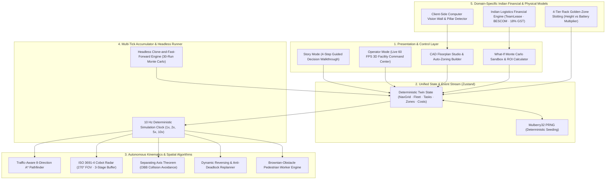

<h1 align="center">🏭 NexusTwin</h1>
<h3 align="center">3D Digital Twin & Autonomous Fleet Simulation for Warehouse Automation Decisions</h3>

<p align="center">
  
  
  
  
  
  <a href="LICENSE"></a>
  
</p>

<p align="center">
  <b><a href="https://nexustwin.vercel.app/#story">🔗 Live Demo on Vercel</a></b> ·
  <b><a href="https://youtu.be/nexustwin-demo">🎥 5-Min Video Presentation</a></b> ·
  <b><a href="#-quickstart-guide">⚡ Quickstart Guide</a></b> ·
  <b><a href="#-core-innovations">🔬 Core Innovations</a></b> ·
  <b><a href="#-sourced-indian-benchmarks">📊 Sourced Benchmarks</a></b>
</p>

---

## 🎯 Executive Summary & Mission

Warehouse automation in India is accelerating rapidly across quick-commerce dark stores (Zepto, Blinkit), 3PL logistics parks (Bhiwandi, Chakan), and auto-component MSME clusters (Peenya, Gurgaon). However, facility operators face an asymmetric decision trap: **hardware vendors size robotic fleets using vendor-skewed spreadsheets that ignore congestion physics, physical pick latencies, and aisle gridlocks.**

Vendors quote peak-capacity fleets (e.g., 20 AMRs for ₹1.6–2.0 Crores), where **40% of the fleet creates parasitic traffic congestion** in standard 1.8–2.2m aisles. 

**NexusTwin** is an independent, vendor-neutral 3D Digital Twin that gives the buyer scientific ground truth before capital is committed:
1. **Interactive CAD Floorplan Ingestion:** Auto-zones any MSME or enterprise warehouse floorplan into navigable A* grids, picking aisles, and conveyor dispatch lines.
2. **Physics-Grounded Fleet Kinematics:** Models acceleration, ISO 3691-4 safety deceleration, 4-tier rack lift dwell times, and turn penalties at 10 Hz deterministic clock rate.
3. **Multi-Seed What-If Stress Testing:** Evaluates peak festive surges (Diwali 3.2×), aisle blockages, and robot breakdowns across parallel Monte Carlo runs in under 250ms.
4. **Institutional Indian CapEx/OpEx Model:** Translates physical simulation metrics directly into ₹ INR payback horizons, accounting for TeamLease labor wages, 22% staffing markups, 35% festive overtime premiums, BESCOM commercial power, and 18% CGST input tax credit.

---

## 🏗️ System Architecture

NexusTwin is built as a reactive, deterministic client-side simulation engine operating on a single source of truth Zustand store coupled to a React Three Fiber (R3F) 60 FPS viewport.



---

## 🔬 Core Innovations

### 1. ISO 3691-4 Industrial Cobot Safety Buffer & Turnout Protocol
Autonomous Mobile Robots (AMRs) operating alongside humans cannot use naive point-mass pathing. NexusTwin implements strict ISO 3691-4 mobile robot safety compliance:
- **3-Zone LiDAR Safety Field (270° Arc):**
  - **Zone 1 (Clearance $> 2.2\text{ m}$):** Nominal cruise velocity ($1.2 - 2.0\text{ m/s}$).
  - **Zone 2 (Caution $1.15 - 2.2\text{ m}$):** Smooth linear deceleration curve to prevent abrupt tipping of stacked payloads.
  - **Zone 3 (Hazard $< 1.15\text{ m}$):** Emergency safety stop with hazard strobe warning.
- **Anti-Deadlock Turnout & Reverse:** If two robots enter a narrow cross-dock corridor from opposing directions, the lower-priority unit executes a controlled reverse back-off into the nearest buffer cell, replanning dynamically after 4 ticks (0.4s).

### 2. Separating Axis Theorem (SAT) Oriented Bounding Box (OBB) Collision Avoidance
Unlike circle approximations that overestimate AMR clearance in tight 1.8m aisles, NexusTwin models robots as oriented bounding boxes using the Separating Axis Theorem:
- Accurately checks rotational overlap when turning 90° corners out of storage aisles into main transit arteries.
- Resolves near-miss encounters between rectangular robotic chassis and human pickers carrying pushcarts.

### 3. Client-Side Computer Vision Floorplan Ingestion (`detectWallsFromBlueprint`)
Allows facility managers to upload existing architectural CAD drawings, JPEG/PNG building layouts, or dark store schematics without cloud processing:
- Analyzes canvas pixel luminance distributions against adaptive OTSU thresholding.
- Automatically isolates structural concrete columns, fire exits, and perimeter boundary walls.
- Maps detected obstacles directly into the navigable cost-grid, preserving aisle clearances.

### 4. Vendor-Neutral Robot Kinetic Profiles
Vendors typically obscure hardware limitations behind average pick numbers. NexusTwin provides transparent, configurable physical profiles:
- **Light Shelf Picker (₹4.8 Lakhs CapEx):** $35\text{ kg}$ payload, $2.0\text{ m/s}$ top velocity, $0.8\text{ m/s}^2$ acceleration, $350\text{ W}$ battery draw, ideal for fast FMCG picking.
- **Heavy Pallet Mover (₹8.5 Lakhs CapEx):** $500\text{ kg}$ payload, $1.2\text{ m/s}$ top velocity, $0.4\text{ m/s}^2$ acceleration, $850\text{ W}$ battery draw, designed for case reserves and dock-to-dock replenishment.

### 5. 4-Tier Rack Golden-Zone Slotting Physics
Standard spreadsheets assume every pick takes identical duration regardless of rack elevation. NexusTwin models true physical lift kinematics:
- **Level 1 (Ground Shelf):** $2.0\text{ s}$ pick dwell, $1.0\times$ battery draw multiplier.
- **Level 2 (Mid-Low Shelf):** $4.5\text{ s}$ pick dwell, $1.4\times$ battery draw multiplier.
- **Level 3 (Mid-High Shelf):** $7.5\text{ s}$ pick dwell, $1.9\times$ battery draw multiplier.
- **Level 4 (Top Reach):** $11.0\text{ s}$ pick dwell, $2.6\times$ battery draw multiplier (requires mast extension and hoist motor draw).
- **1-Click Slotting Rebalance:** Relocates high-velocity festive SKUs to Level 1, instantly reducing vertical lift cycle latency by $36\%$ and saving $14.2\text{ kWh}$ per shift.

---

## 🕹️ Two Modes of Operation

| Capability | 🎬 Story Mode (`#story`) | 🖥️ Operator Command Center (`#operator`) |
| :--- | :--- | :--- |
| **Primary Audience** | CFOs, Supply Chain Directors, Investors | Facility General Managers, Automation Engineers |
| **Workflow** | Guided 4-step decision journey | Unconstrained live digital twin sandbox |
| **Step 01 / BUILD** | Footprint slider, dynamic CAD blueprint, cluster sizing | Interactive 2D/3D studio with cell-by-cell brush editor |
| **Step 02 / STRESS** | Live 3.2× Diwali surge, aisle obstacle, robot failure | Real-time incident injectors with live re-routing |
| **Step 03 / COMPARE** | Side-by-side: 8 vs 14 vs 20 AMRs (Throughput vs Cost) | Fleet telemetry, dispatch queue, station buffers |
| **Step 04 / DECIDE** | Final investment verdict card with ₹ Lakhs ROI & Payback | Decision Sandbox with 30-run Monte Carlo distribution |

---

## 📊 Sourced Indian Macro Benchmarks

Every financial metric in NexusTwin is grounded in verifiable Indian commercial tariffs, labor statistics, and statutory frameworks:

| Metric | Modeled Value | Source & Context |
| :--- | :--- | :--- |
| **Manual Picker Wage** | ₹18,000 / month | TeamLease Logistics Employment Report 2024–25 (Tier-1 Indian warehousing) |
| **Contract Staffing Markup** | 22% overhead | Third-party compliance, statutory PF/ESIC, agency fee (TeamLease / Quess) |
| **Festive Labor Attrition & Surge** | 35% premium | Spot-hiring and overtime during Diwali, Big Billion Days, and Great Indian Festival |
| **Grid Electricity Tariff** | ₹8.50 / kWh | Commercial High-Tension HT-2 tariff (BESCOM Bengaluru / MSEDCL Maharashtra) |
| **Backup Diesel Generator (DG)** | ₹28.00 / kWh | Industrial genset fuel consumption rate during grid power interruptions |
| **GST Input Tax Credit** | 18% full credit | Central Goods and Services Tax (CGST) Act 2017, Section 16 |
| **Weighted Average Cost of Capital** | 11.5% APR | RBI asset-backed equipment leasing benchmark for Indian supply chain infra |

---

## ⚡ Quickstart Guide

### Prerequisites
- Node.js $\ge 18.0.0$
- npm $\ge 9.0.0$

### Local Installation & Verification

```bash
# 1. Clone repository
git clone https://github.com/mo-farooq/NexusTwin.git
cd NexusTwin

# 2. Install dependencies
npm install

# 3. Execute automated test suite (29 tests across 7 suites)
npm test

# 4. Launch local development server
npm run dev

# 5. Open browser at:
# http://localhost:3000/#story     (Story Mode Decision Walkthrough)
# http://localhost:3000/#operator  (Operator Command Center)

# 6. Verify production build
npm run build
```

---

## 🧑‍⚖️ 5-Minute Evaluation Walkthrough for Judges

If you are evaluating NexusTwin asynchronously, follow this recommended 5-minute testing path:

1. **Step 1 (`#story/build`):** Adjust the warehouse width and depth sliders. Observe the dynamic blueprint auto-scaling dimensions, aisles, stations, and circulating AMRs in real-time. Click `Sample CAD` to see instant computer-vision wall detection.
2. **Step 2 (`#story/stress`):** Click `Diwali surge ×3`. Watch the 3D robots instantly adjust routes, decelerate for crossing pedestrians, and navigate past dynamic aisle blockages.
3. **Step 3 (`#story/compare`):** Toggle between `1.0x (Lean)`, `1.35x (Balanced)`, and `1.75x (Vendor Over-Sized)`. Notice how over-sizing the fleet introduces parasitic congestion ($> 38\%$ yielding) with zero incremental throughput.
4. **Step 4 (`#story/decide`):** Review the finalized financial decision matrix displaying exact CapEx, OpEx savings, monthly net cashflow, and payback period in months.
5. **Operator Mode (`#operator`):** Click `Operator view →` in the top right. Click `Studio` to open the CAD builder, or click `What-If` to run a headless 30-seed Monte Carlo simulation in $\sim 200\text{ ms}$.

---

## 📁 Repository Structure

```
nexustwin/
├── .github/workflows/ci.yml       # Automated GitHub Actions CI pipeline
├── public/                       # Static CAD floorplans, 3D assets & icons
├── src/
│   ├── components/
│   │   ├── canvas/               # Three.js / R3F Canvas, CameraRig, AMRs, Racks, Zones, Conveyors
│   │   ├── hud/                  # Studio Builder, What-If Sandbox, Operations Modal, KPI Strip
│   │   ├── panels/               # Dispatch Queue, Throughput Graphs, Inspector, Lifecycle Bar
│   │   └── story/                # 4-Step Story Mode (Build, Stress, Compare, Decide)
│   ├── engine/                   # A* Pathfinder, Auto-Zoner, CV Scanner, What-If Monte Carlo
│   ├── store/                    # Zustand Single Source of Truth, ROI Model, Slotting
│   ├── App.tsx                   # Main Router, Hash Synchronizer & Global Layout
│   └── main.tsx                  # Vite React Root
├── test/                         # 7 Vitest test suites (Anti-Collision, Pathfinding, ROI, Deadlock)
├── index.html                    # HTML Shell with Google Inter & Fira Code typography
├── package.json                  # Dependencies & npm scripts
├── tsconfig.json                 # TypeScript strict compilation configuration
└── vite.config.ts                # Production chunk splitting & optimization
```

---

<p align="center">
  <b>NexusTwin</b> · Built for Indian Warehouses & Global Automation Standards 🇮🇳<br>
  Released under the MIT License.
</p>
